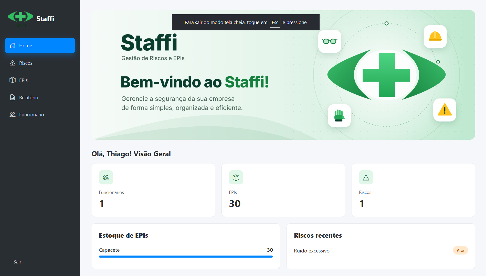

<p align="center">
  
</p>

# Staffi

> A segurança no trabalho é responsabilidade coletiva

---

## Informações acadêmicas

| | |
|---|---|
| **Instituição** | Fatec Diadema Luigi Papaiz |
| **Disciplina chave** | Engenharia de Software II |
| **Disciplinas satélites** | Banco de Dados Relacional II, Desenvolvimento Web II |

---

## Sobre o projeto

O **Staffi** nasceu com o objetivo de facilitar o trabalho do dia a dia do técnico em segurança do trabalho, diminuindo a burocracia dos processos com o uso de tecnologia. Assim, o profissional pode estar presente nas situações em que ele é essencial, como a supervisão do uso de Equipamentos de Proteção Individual (EPIs) e a manutenção e prevenção de riscos ocupacionais.

> **Nota:** Este README reúne a apresentação principal do software.

---

## Tecnologias

- HTML, CSS e JavaScript
- React (front-end)
- Node.js / NestJS (back-end)
- MySQL (banco de dados)

---

## Onde encontrar

Aplicação web: [https://staffi-pi-v53s.vercel.app/home](https://staffi-pi-v53s.vercel.app/home)

---

## Funcionalidades

- [x] Login e cadastro de usuário
- [x] Página de visualização geral (Home)
- [x] Página de cadastro e registro de riscos
- [x] Página de gerenciamento de EPIs
- [x] Página de funcionários
- [x] Página de relatórios

---

## Como baixar e executar o projeto

### Pré-requisitos

- [Git](https://git-scm.com/)
- [Node.js](https://nodejs.org/) (versão LTS) e npm
- [MySQL](https://www.mysql.com/) (pode ser via XAMPP) e, opcionalmente, o MySQL Workbench

### 1. Clonar o repositório

```bash
git clone <URL-DO-REPOSITORIO>
cd StaffiPI
```

### 2. Criar o banco de dados

No MySQL Workbench (ou pelo terminal), crie o banco que será usado pela aplicação:

```sql
CREATE DATABASE staffi;
```

### 3. Configurar o back-end

```bash
cd back-end
npm install
```

Crie um arquivo `.env` na raiz da pasta do back-end, com os dados do seu MySQL:

```env
DB_HOST=localhost
DB_PORT=3306
DB_USERNAME=root
DB_PASSWORD=sua_senha
DB_DATABASE=staffi
```

> Se o seu MySQL não tem senha (como no XAMPP padrão), deixe `DB_PASSWORD=` vazio.

Inicie o servidor:

```bash
npm run start:dev
```

### 4. Configurar o front-end

Em outro terminal, a partir da raiz do projeto:

```bash
cd front-end
npm install
npm run dev
```

Se o front-end precisar saber o endereço da API, informe no `.env` dele:

```env
VITE_API_URL=http://localhost:3000
```

### 5. Acessar

Abra o endereço mostrado no terminal do front-end (por exemplo, `http://localhost:5173`).

---

## Autor

Equipe Staffi.

---

## Licença

Todos os direitos reservados @2026
